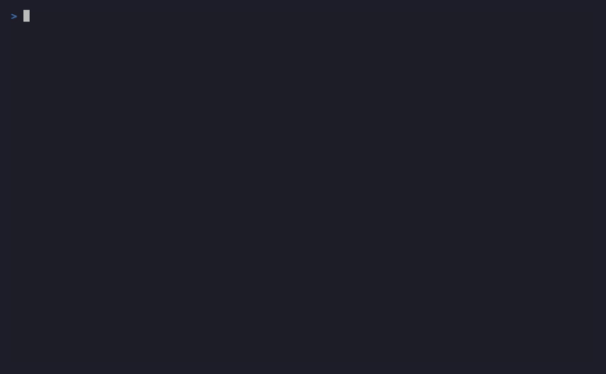

[简体中文](./README.zh-CN.md) · [Website](https://slopaudit.lei6393.com) · [GitHub](https://github.com/SuperMarioYL/slopaudit)

<picture>
  <source media="(max-width: 600px) and (prefers-color-scheme: dark)" srcset="./assets/presentation/hero-mobile-dark.svg">
  <source media="(max-width: 600px)" srcset="./assets/presentation/hero-mobile-light.svg">
  <source media="(prefers-color-scheme: dark)" srcset="./assets/presentation/hero-dark.svg">
  
</picture>

# SlopAudit

**Find code patterns that deserve a closer review.**

SlopAudit scans JavaScript and TypeScript, reports heuristic findings with file and line evidence, and summarizes their weighted density as a 0–100 score.

## Why use it

A long list of possible issues needs a starting point. File rankings and concrete evidence help a reviewer choose where to read first, while a consistent threshold can flag a change in CI.

- **Start from evidence** — Findings identify a line and matching pattern.
- **Rank files consistently** — Per-file scores use each file’s line count.
- **Use an explicit threshold** — The same score drives JSON and CI outcomes.

## Architecture

<picture>
  <source media="(max-width: 600px) and (prefers-color-scheme: dark)" srcset="./assets/presentation/architecture-mobile-dark.svg">
  <source media="(max-width: 600px)" srcset="./assets/presentation/architecture-mobile-light.svg">
  <source media="(prefers-color-scheme: dark)" srcset="./assets/presentation/architecture-dark.svg">
  
</picture>

The file walker applies source globs and exclusions. Babel parsing feeds five detector families: over-abstraction, generic boilerplate, plausible-but-wrong patterns, dead parameters and copy-paste clones. Weighted findings per line feed the score; reports and the optional threshold gate consume that same result.

| Component | Responsibility |
| --- | --- |
| `Source inventory` | src/scan/walk.ts |
| `Babel AST` | src/scan/parse.ts |
| `Five detectors` | src/detectors |
| `Density score` | src/score/aggregate.ts |
| `Reports + gate` | src/report; src/gate |

## Install and quickstart

Use the runtime version declared in the repository manifest. The source installation below makes the included example reproducible.

```bash
git clone https://github.com/SuperMarioYL/slopaudit.git
cd slopaudit
npm ci
npm run build
```

Node.js 22+ and Python 3; the driver audits a temporary add.js twice and checks both expected gate statuses.

```bash
python3 examples/presentation_demo.py
```

## Recorded demo

<picture>
  <source media="(max-width: 600px) and (prefers-color-scheme: dark)" srcset="./assets/presentation/process-mobile-dark.svg">
  <source media="(max-width: 600px)" srcset="./assets/presentation/process-mobile-light.svg">
  <source media="(prefers-color-scheme: dark)" srcset="./assets/presentation/process-dark.svg">
  
</picture>

The unreachable statement triggers a finding and exit 1; removing it gives zero findings and exit 0.

```text
{
  "state": "before",
  "score": 100,
  "band": "heavy",
  "files": 1,
  "findings": [
    {
      "line": 3,
      "category": "plausible_but_wrong",
      "evidence": "unreachable code after return"
    }
  ],
  "exit_code": 1
}
{
  "state": "after",
  "score": 0,
  "band": "clean",
  "files": 1,
  "findings": [],
  "exit_code": 0
}
```

The complete command and output are recorded in [docs/demo-results.json](./docs/demo-results.json). Inputs and reproduction code are included in the repository.



The existing recording is retained for context; the text example above documents the reproducible scenario.

## Usage

Run these commands from the repository root after installation. Replace paths for your own data.

```bash
node dist/cli.js ./src --json
node dist/cli.js ./src --no-html --no-badge --fail-on heavy
node dist/cli.js . --ignore "examples/**" --ignore "bench/**"
node dist/cli.js ./src --format github
```

## Configuration

--fail-on accepts a score 0–100 or clean/moderate/heavy and fails at or above that threshold. Bands are clean below 34, moderate through 66 and heavy from 67. Exit 1 means the gate tripped; an empty scan or invalid threshold gives 2. --list inventories files and cannot be combined with --fail-on. Default text mode writes slopaudit-report.html and slopaudit-badge.svg in the current directory; --json does not. The Action exposes path, fail-on, version and newline-separated ignore inputs; pin the version deliberately.

```yaml
- uses: actions/checkout@v4
- uses: SuperMarioYL/slopaudit@v0.15.0
  with:
    path: .
    version: "0.15.0"
    fail-on: heavy
    ignore: |
      examples/**
      bench/**
```

## Integrations and responsibilities

<picture>
  <source media="(max-width: 600px) and (prefers-color-scheme: dark)" srcset="./assets/presentation/integrations-mobile-dark.svg">
  <source media="(max-width: 600px)" srcset="./assets/presentation/integrations-mobile-light.svg">
  <source media="(prefers-color-scheme: dark)" srcset="./assets/presentation/integrations-dark.svg">
  
</picture>

Choose the input and output route that matches your workflow. The local example below exercises the stated subset.

| Route | Implemented role |
| --- | --- |
| JS / TS variants | Including JSX, TSX, MJS and CJS |
| JSON | Machine-readable findings and score |
| HTML + SVG | Local report and score badge |
| GitHub annotations | Per-line workflow warnings |
| Composite Action | Threshold and job summary |

## Limits and next steps

- Heuristic findings do not establish AI authorship, prove a defect or measure total technical debt. Review each finding in context.
- The score depends on weighted findings, scanned line counts and exclusions. A lower score alone is not evidence of improved program behavior.
- Parsing can recover with warnings and some checks are local rather than whole-program analysis. The demo is a handwritten fixture, not a benchmark.

Future detector changes should be driven by minimal false-positive and false-negative examples; runtime correctness remains the responsibility of tests and reviewers.

## License and contributions

See [LICENSE](./LICENSE). When reporting an issue, include a minimal input, the command, and the observed output.
