[English](./README.md) · [Website](https://slopaudit.lei6393.com) · [GitHub](https://github.com/SuperMarioYL/slopaudit)

<picture>
  <source media="(max-width: 600px) and (prefers-color-scheme: dark)" srcset="./assets/presentation/hero-mobile-dark.svg">
  <source media="(max-width: 600px)" srcset="./assets/presentation/hero-mobile-light.svg">
  <source media="(prefers-color-scheme: dark)" srcset="./assets/presentation/hero-dark.svg">
  
</picture>

# SlopAudit

**找出值得进一步检查的代码模式。**

SlopAudit 扫描 JavaScript 与 TypeScript，按文件和行报告启发式问题，并把加权密度汇总为 0–100 分数。

## 为什么需要它

可能的问题列表很长时，需要检查起点。文件排行与具体证据帮助审阅者决定先读哪里，一致的阈值也可在 CI 中提示变化。

- **从证据开始** — 问题指出具体行与命中模式。
- **一致排列文件** — 文件分数使用各自的行数。
- **使用明确阈值** — JSON 与 CI 裁决使用同一分数。

## 架构

<picture>
  <source media="(max-width: 600px) and (prefers-color-scheme: dark)" srcset="./assets/presentation/architecture-mobile-dark.svg">
  <source media="(max-width: 600px)" srcset="./assets/presentation/architecture-mobile-light.svg">
  <source media="(prefers-color-scheme: dark)" srcset="./assets/presentation/architecture-dark.svg">
  
</picture>

文件遍历按源码 glob 与排除规则收集输入；Babel 解析后交给五类检测器：过度抽象、通用样板、疑似错误模式、无用参数与复制克隆。每行加权问题密度形成分数，报告和可选阈值门禁使用同一结果。

| 组件 | 职责 |
| --- | --- |
| `Source inventory` | src/scan/walk.ts |
| `Babel AST` | src/scan/parse.ts |
| `Five detectors` | src/detectors |
| `Density score` | src/score/aggregate.ts |
| `Reports + gate` | src/report; src/gate |

## 安装与快速上手

使用仓库清单声明的运行时版本。以下源码安装步骤可复现随仓示例。

```bash
git clone https://github.com/SuperMarioYL/slopaudit.git
cd slopaudit
npm ci
npm run build
```

需要 Node.js 22+ 与 Python 3；驱动两次检查临时 add.js，并核验预期门禁状态。

```bash
python3 examples/presentation_demo.py
```

## 实际运行示例

<picture>
  <source media="(max-width: 600px) and (prefers-color-scheme: dark)" srcset="./assets/presentation/process-mobile-dark.svg">
  <source media="(max-width: 600px)" srcset="./assets/presentation/process-mobile-light.svg">
  <source media="(prefers-color-scheme: dark)" srcset="./assets/presentation/process-dark.svg">
  
</picture>

The unreachable statement triggers a finding and exit 1; removing it gives zero findings and exit 0.

```text
{
  "state": "before",
  "score": 100,
  "band": "heavy",
  "files": 1,
  "findings": [
    {
      "line": 3,
      "category": "plausible_but_wrong",
      "evidence": "unreachable code after return"
    }
  ],
  "exit_code": 1
}
{
  "state": "after",
  "score": 0,
  "band": "clean",
  "files": 1,
  "findings": [],
  "exit_code": 0
}
```

完整命令与输出保存在 [docs/demo-results.json](./docs/demo-results.json). 输入和复现代码均随仓提供。


保留已有录制供参考；上方文字示例给出当前可复现的操作。

## 用法

安装后在仓库根目录运行以下命令；处理自己的数据时替换相应路径。

```bash
node dist/cli.js ./src --json
node dist/cli.js ./src --no-html --no-badge --fail-on heavy
node dist/cli.js . --ignore "examples/**" --ignore "bench/**"
node dist/cli.js ./src --format github
```

## 配置

--fail-on 接受 0–100 分数或 clean/moderate/heavy，到达或超过阈值即失败。低于 34 为 clean，至 66 为 moderate，67 起为 heavy。门禁触发返回 1；空扫描、无效阈值或无法识别的 --format 返回 2。--list 只列文件，不能与 --fail-on、--json 或 --format 组合。默认文本模式在当前目录写 slopaudit-report.html 和 slopaudit-badge.svg，--json 不写。Action 支持 path、fail-on、version 与按行分隔的 ignore，应明确固定版本。

```yaml
- uses: actions/checkout@v4
- uses: SuperMarioYL/slopaudit@v0.18.0
  with:
    path: .
    version: "0.18.0"
    fail-on: heavy
    ignore: |
      examples/**
      bench/**
```

## 集成与职责分工

<picture>
  <source media="(max-width: 600px) and (prefers-color-scheme: dark)" srcset="./assets/presentation/integrations-mobile-dark.svg">
  <source media="(max-width: 600px)" srcset="./assets/presentation/integrations-mobile-light.svg">
  <source media="(prefers-color-scheme: dark)" srcset="./assets/presentation/integrations-dark.svg">
  
</picture>

根据工作流选择输入与输出路径。本文本地示例验证其中明确说明的子流程。

| 路径 | 已实现职责 |
| --- | --- |
| JS / TS variants | Including JSX, TSX, MJS and CJS |
| JSON | Machine-readable findings and score |
| HTML + SVG | Local report and score badge |
| GitHub annotations | Per-line workflow warnings |
| Composite Action | Threshold and job summary |

## 限制与后续方向

- 启发式结果不证明 AI 创作、不证明缺陷，也不衡量全部技术债；每条问题都需结合上下文检查。
- 分数依赖问题权重、扫描行数与排除范围；分数降低本身不证明程序行为改善。
- 解析可能在警告后继续恢复，部分检查只分析局部而非完整程序；示例是手写 fixture，不是基准测量。

后续检测改进应由最小误报、漏报样例驱动；运行正确性仍由测试与审阅者负责。

## 许可与贡献

许可见 [LICENSE](./LICENSE). 反馈问题时请提供最小输入、执行命令和实际输出。
